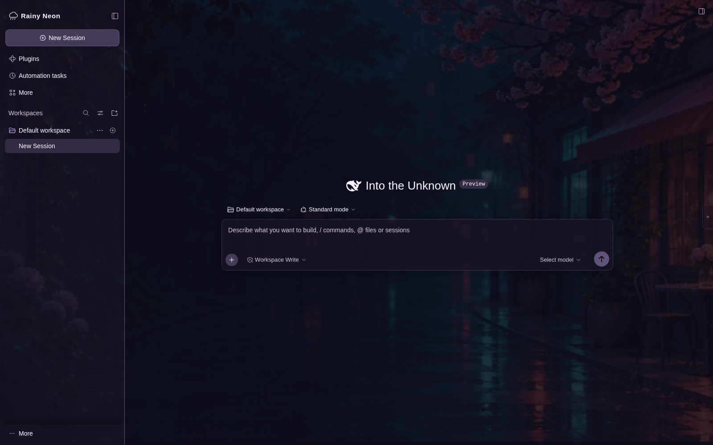
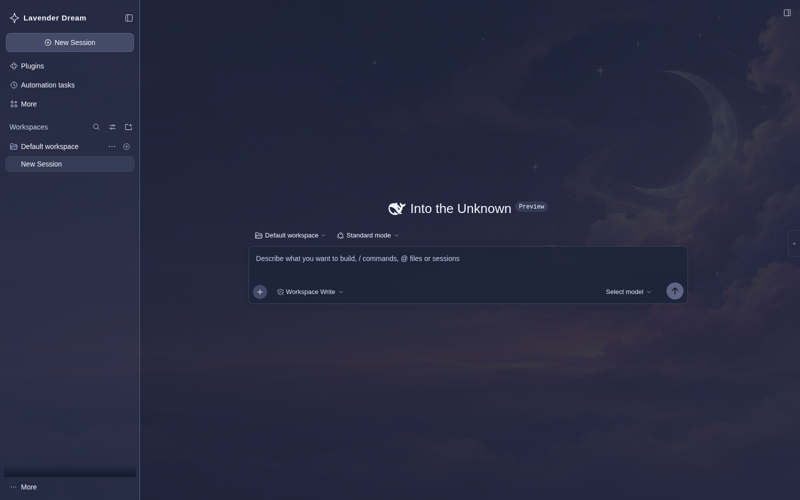
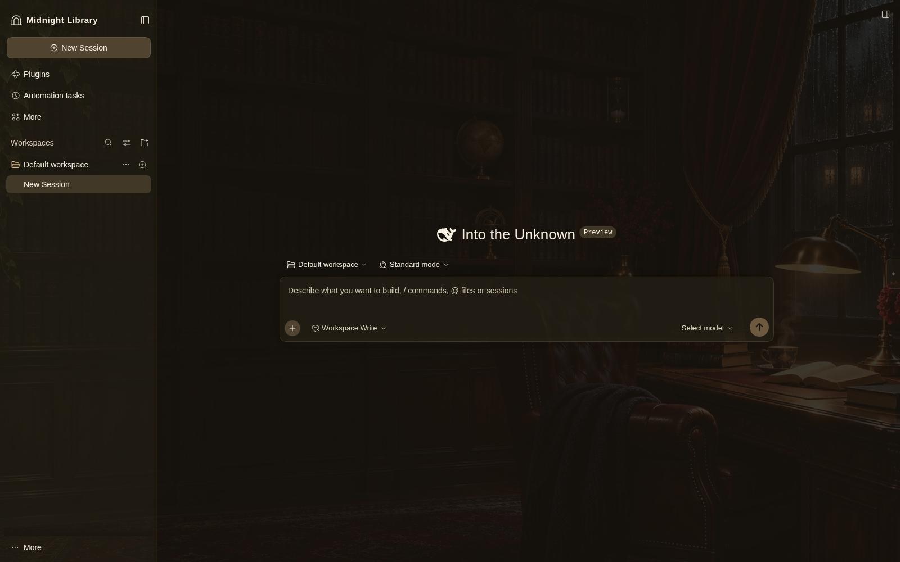

# DSH Skins

**English** · [简体中文](README.zh.md)

Downloadable skins for DeepSeek Harness Web. Install [dsh-skin](https://github.com/bigm4ngo/dsh-skin) to load this collection in DSH and switch between skins.

> **Dark mode first.** These skins are designed for DSH's dark theme. The backgrounds are dim, moody plates and the palettes are tuned to sit on top of them; light mode is shipped as a compatibility fallback, not as a design target.

## Highlights



**[Rainy Neon](rainy-neon/)** (video) — a slow rain loop on a quiet street at blue hour, coral and teal reflections on wet pavement. Shown at **dim 0.22**. The neon carries the colour, the dark storefronts carry the text, so the interface stays crisp while the street keeps moving behind it.



**[Lavender Dream](lavender-dream/)** (still) — lilac clouds and silver starlight above a pastel horizon, with a 19px corner radius that matches the softness of the art. Shown at **dim 0.24**. This is the calmest of the set: no moving parts, and the plate is already low-contrast, so it reads well at almost any window size.



**[Midnight Library](midnight-library/)** (still) — a walnut library at night, brass desk lamp, rain on the window, set in Georgia. Shown at **dim 0.26**. Its plate is darker than the other two, so it needs a little less dim to show the artwork; text still clears 11:1.

These are real renders of DSH 0.2.2-rc.1 with the skin applied, not mockups. Each is shown a little brighter than the skin's default dim (0.38) so the artwork is visible in the README; the 4.5:1 text-contrast floor is kept — the weakest label in these three shots measures 10.58:1. Every colour pair in the collection is authored to the same floor. Drag the **Dim** slider under **Settings → Skins** if your monitor or wallpaper needs more headroom.

## Browse the collection

Each skin folder contains a manifest, background, and sidebar mark. The collection has 40 still backgrounds and 14 silent, 10-second video loops. Each skin has light and dark palettes for messages, menus, the composer, sidebars, buttons, active tabs, send controls, and running status. The running status uses the skin’s own mark.

| Interest | Still backgrounds | Video background |
| --- | --- | --- |
| Natural landscapes | [Alpine Dawn](alpine-dawn/), [Redwood Rain](redwood-rain/), [Lichen Coast](lichen-coast/), [Salt Horizon](salt-horizon/), [Copper Canyon](copper-canyon/), [Glacier Blue](glacier-blue/), [Moss & Mist](moss-and-mist/), [Dune Sea](dune-sea/), [Cloudline](cloudline/) | [Aurora Basin](aurora-basin/), [Winter Pines](winter-pines/), [Night Tide](night-tide/) |
| Music | [Amber Overdrive](amber-overdrive/), [Cedar Workbench](cedar-workbench/), [Tape Room](tape-room/), [Violet Stage](violet-stage/) | [String Theory](string-theory/), [Signal Chain](signal-chain/) |
| Fantasy worlds | [Sunward Citadel](sunward-citadel/), [Orchid Crossing](orchid-crossing/), [Gilded Harbour](gilded-harbour/), [Lantern Hollow](lantern-hollow/) | [Hextech Observatory](hextech-observatory/) |
| Science fiction games | [Aiur Temple](aiur-temple/), [Zerg Creep](zerg-creep/), [Orbital Salvage](orbital-salvage/) | [Terran Orbit](terran-orbit/), [Crystal Caverns](crystal-caverns/) |
| Design studios | [Form & Field](form-and-field/) | [Chromatic Grid](chromatic-grid/) |
| Tech, AI, and security | [Latent Space](latent-space/) | [Zero Trust](zero-trust/) |
| Painting | [Starry Night](starry-night/) | |

## More skins

- **Cosy interiors** — [Midnight Library](midnight-library/), [Blue Hour Café](blue-hour-cafe/), [Golden Hour Records](golden-hour-records/) and [Cat & Window](cat-and-window/) (video).
- **Nature and calm** — [Matcha Morning](matcha-morning/), [Quiet Greenhouse](quiet-greenhouse/), [Terrarium World](terrarium-world/), [Ocean Porcelain](ocean-porcelain/), [Orchid Noir](orchid-noir/), [Winter Teahouse](winter-teahouse/) and [Forest Cabin](forest-cabin/) (video).
- **Dreamy and atmospheric** — [Lavender Dream](lavender-dream/), [Rose Quartz](rose-quartz/), [Origami Sky](origami-sky/), [Rainy Neon](rainy-neon/) (video) and [Space Drift](space-drift/) (video).
- **Design and retro** — [Paper Garden](paper-garden/), [Desert Terracotta](desert-terracotta/), [Soft Geometry](soft-geometry/), [Celestial Atlas](celestial-atlas/) and [Retro Terminal](retro-terminal/).

## Download and apply a skin

1. Install the [dsh-skin plugin](https://github.com/bigm4ngo/dsh-skin) into the DSH web profile. The plugin supports DeepSeek Harness 0.2.2-rc.x.

   ```sh
   dsh plugin --profile web add github:bigm4ngo/dsh-skin
   ```

2. [Download the collection ZIP](https://github.com/bigm4ngo/dsh-skins/archive/refs/heads/main.zip) and extract it. Copy the skin folder you want into `~/.config/dsh/skins/`. Keep its `skin.json`, background, and logo together.

   ```sh
   # Run from the extracted dsh-skins-main directory
   mkdir -p ~/.config/dsh/skins
   cp -R ./lavender-dream ~/.config/dsh/skins/
   ```

3. Start or restart `dsh web`, then open **Settings → Skins** and select your skin. Reload the browser after adding more folders. The collection is drawn for **dark mode** — switch the theme to dark in **Settings → General** if it is not already.

### Try all 54 skins from a checkout

```sh
git clone https://github.com/bigm4ngo/dsh-skins.git
cd dsh-skins
DSH_SKINS_DIR="$PWD" dsh web
```

This points that DSH Web process at the collection. Run `dsh web` as usual to return to your default skins directory.

### Compatibility

The plugin applies the palettes in both light and dark mode. Some shell controls use built-in styles. The macOS sidebar's New Session background and the collapsed sidebar's idle New Session button are examples on DSH 0.2.2-rc.1.

## Edit a palette

Edit the `dark` and `light` palettes in `skin.json` and refresh DSH Web. Keep the foreground and surface together when changing a colour. The authored surface and text pairs in this collection target at least 4.5:1 contrast.

| Surface | Fill | Text |
| --- | --- | --- |
| Messages | `specific-bubble`, `specific-bubble-highlight` | `label-primary` |
| Menus | `specific-menu`, `menu-surface-fill`, `alias-menu-group-header-fill` | `label-secondary`, `alias-menu-icon` |
| Composer and chips | `bg-layer-3`, `specific-input-major` | `label-primary`, `label-primary-dimmed` |
| Sidebar, rows, and toolbars | `specific-sidebar-fill`, `interactive-bg-hover`, `interactive-bg-active`, `button-tool-bar-fill`, `button-tool-bar-hover` | `label-primary` |
| Primary actions | `button-primary-fill`, `button-primary-hover` | `label-primary-foreground` |
| New Session and composer + | `button-elevated-fill`, `button-floating-hover`, `specific-selector` | `label-primary` |

For a surface outside the table, inspect the element in DevTools, open **Computed**, and filter for `--dsw`. Use the matching name in the manifest as described in [DSH Skin Format §5](https://github.com/bigm4ngo/dsh-skin/blob/main/SKIN-FORMAT.md#5-which-token-paints-what). Set the live corner radius with the **Corner radius** slider under **Settings → Skins**. The current loader accepts colours in the palette and rejects CSS lengths for `radius-*` keys.

## Artwork

Sunward Citadel, Orchid Crossing, and Gilded Harbour use generated environments from original prompts.

ImageGen supplied the recent stills and the image plates behind the recent video backgrounds. HyperFrames supplied the motion for all video backgrounds. Aiur Temple, Zerg Creep, and Terran Orbit are StarCraft II-inspired fan themes with generated artwork.

The latest collection’s generation prompts are in [ARTWORK-PROMPTS.md](ARTWORK-PROMPTS.md).

## Report an issue

For an artwork or palette issue, open an issue in [this collection](https://github.com/bigm4ngo/dsh-skins/issues) and include the skin name, light or dark mode, and the affected control. For plugin installation or skin loading issues, use the [dsh-skin plugin repository](https://github.com/bigm4ngo/dsh-skin/issues).
