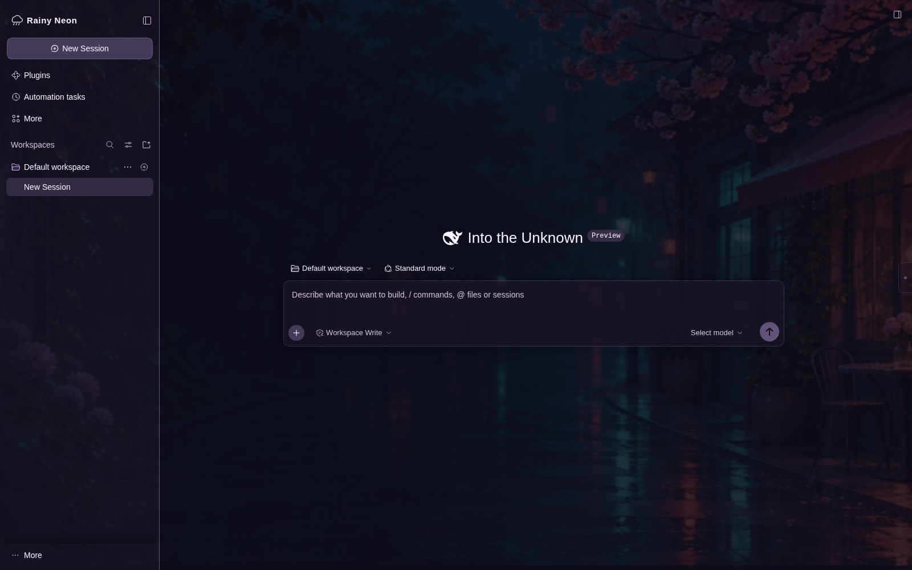
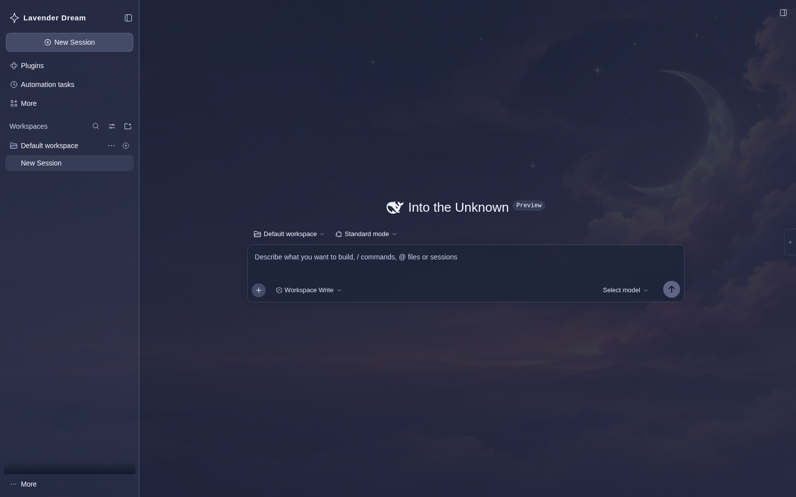
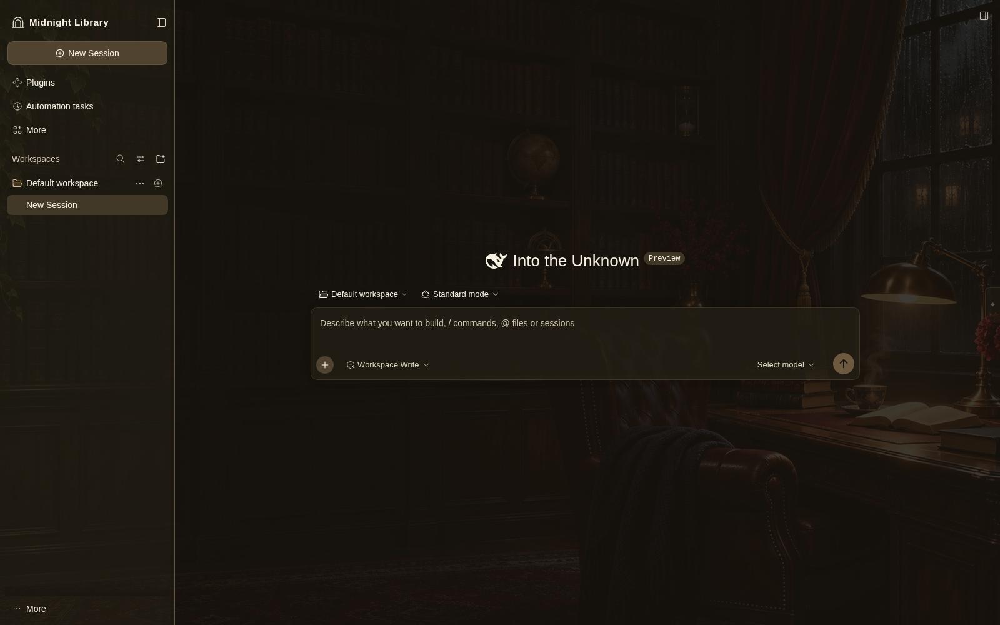

# DSH Skins

[English](README.md) · **简体中文**

给 **DeepSeek Harness Web** 换皮肤用的合集。装上 [dsh-skin](https://github.com/bigm4ngo/dsh-skin) 就能把这套皮肤加载进 DSH，
在它们之间随意切换。

> **为深色模式设计。** 这套皮肤是照着 DSH 的深色主题做的：背景都是压暗过的氛围图，配色也是按「浮在上面」调的。
> 浅色模式只是能用的兜底，不是设计目标——想让皮肤好看，请用深色模式。

## 精选



**[Rainy Neon 雨夜霓虹](rainy-neon/)**（视频）——蓝调时刻的安静小街，慢镜头雨丝，湿路面上漾开珊瑚色和青色的霓虹倒影。
截图里压暗程度是 **0.22**。颜色交给霓虹，文字交给暗下来的店面，所以界面一直清爽，街景在背后慢慢动。



**[Lavender Dream 薰衣草之梦](lavender-dream/)**（静态图）——淡紫云层和银色星光悬在柔和的粉色地平线上，配 19px 圆角，
和画面一样软。截图里压暗程度是 **0.24**。全套里最安静的一个：没有会动的东西，画面本身对比度就低，几乎任何窗口尺寸都好看。



**[Midnight Library 午夜书房](midnight-library/)**（静态图）——夜里点着黄铜台灯的胡桃木书房，窗上落着雨，字体用 Georgia。
截图里压暗程度是 **0.26**。它的底图比前两个更暗，所以要压得轻一点图才看得清，文字对比度仍有 11:1。

上面是三张真机截图：DSH 0.2.2-rc.1 套上皮肤之后的样子，不是效果图。为了让画面在 README 里看得清，压暗程度比皮肤默认的
0.38 调亮了一些；同时守住了 4.5:1 的文字对比度下限——这三张图里最弱的一处实测是 10.58:1，合集里每一组配色都是按同一个下限调的。
如果你的显示器或者壁纸还需要更多余量，在 **设置 → 皮肤** 里拖 **压暗** 滑块就行。

## 浏览合集

每个皮肤文件夹里都有一个清单、一张背景和侧边栏图标。合集一共 40 张静态背景、14 段无声的 10 秒视频循环。
每个皮肤都有明暗两套配色，覆盖消息、菜单、输入框、侧边栏、按钮、当前标签、发送控件和运行状态；运行状态用的是皮肤自己的图标。

| 主题 | 静态背景 | 视频背景 |
| --- | --- | --- |
| 自然风景 | [Alpine Dawn](alpine-dawn/)、[Redwood Rain](redwood-rain/)、[Lichen Coast](lichen-coast/)、[Salt Horizon](salt-horizon/)、[Copper Canyon](copper-canyon/)、[Glacier Blue](glacier-blue/)、[Moss & Mist](moss-and-mist/)、[Dune Sea](dune-sea/)、[Cloudline](cloudline/) | [Aurora Basin](aurora-basin/)、[Winter Pines](winter-pines/)、[Night Tide](night-tide/) |
| 音乐 | [Amber Overdrive](amber-overdrive/)、[Cedar Workbench](cedar-workbench/)、[Tape Room](tape-room/)、[Violet Stage](violet-stage/) | [String Theory](string-theory/)、[Signal Chain](signal-chain/) |
| 奇幻世界 | [Sunward Citadel](sunward-citadel/)、[Orchid Crossing](orchid-crossing/)、[Gilded Harbour](gilded-harbour/)、[Lantern Hollow](lantern-hollow/) | [Hextech Observatory](hextech-observatory/) |
| 科幻游戏 | [Aiur Temple](aiur-temple/)、[Zerg Creep](zerg-creep/)、[Orbital Salvage](orbital-salvage/) | [Terran Orbit](terran-orbit/)、[Crystal Caverns](crystal-caverns/) |
| 设计工作室 | [Form & Field](form-and-field/) | [Chromatic Grid](chromatic-grid/) |
| 科技、AI 与安全 | [Latent Space](latent-space/) | [Zero Trust](zero-trust/) |
| 绘画 | [Starry Night](starry-night/) | |

## 更多皮肤

- **温馨室内** —— [Midnight Library](midnight-library/)、[Blue Hour Café](blue-hour-cafe/)、[Golden Hour Records](golden-hour-records/)
  和 [Cat & Window](cat-and-window/)（视频）。
- **自然与宁静** —— [Matcha Morning](matcha-morning/)、[Quiet Greenhouse](quiet-greenhouse/)、[Terrarium World](terrarium-world/)、
  [Ocean Porcelain](ocean-porcelain/)、[Orchid Noir](orchid-noir/)、[Winter Teahouse](winter-teahouse/) 和
  [Forest Cabin](forest-cabin/)（视频）。
- **梦幻氛围** —— [Lavender Dream](lavender-dream/)、[Rose Quartz](rose-quartz/)、[Origami Sky](origami-sky/)、
  [Rainy Neon](rainy-neon/)（视频）和 [Space Drift](space-drift/)（视频）。
- **设计与复古** —— [Paper Garden](paper-garden/)、[Desert Terracotta](desert-terracotta/)、[Soft Geometry](soft-geometry/)、
  [Celestial Atlas](celestial-atlas/) 和 [Retro Terminal](retro-terminal/)。

## 下载并套用皮肤

1. 把 [dsh-skin 插件](https://github.com/bigm4ngo/dsh-skin)装进 DSH 的 web 配置档。插件支持 DeepSeek Harness 0.2.2-rc.x。

   ```sh
   dsh plugin --profile web add github:bigm4ngo/dsh-skin
   ```

2. [下载合集 ZIP](https://github.com/bigm4ngo/dsh-skins/archive/refs/heads/main.zip)并解压。把想要的皮肤文件夹复制到
   `~/.config/dsh/skins/`，`skin.json`、背景和图标要放在同一个文件夹里。

   ```sh
   # 在解压出来的 dsh-skins-main 目录里执行
   mkdir -p ~/.config/dsh/skins
   cp -R ./lavender-dream ~/.config/dsh/skins/
   ```

3. 启动或重启 `dsh web`，打开 **设置 → 皮肤** 选一个。之后再添加文件夹，刷新一下浏览器就好。
   这套皮肤是为**深色模式**画的——如果当前不是深色，先去 **设置 → 通用** 把主题切成深色。

### 从源码目录里一次试完 54 个皮肤

```sh
git clone https://github.com/bigm4ngo/dsh-skins.git
cd dsh-skins
DSH_SKINS_DIR="$PWD" dsh web
```

这样只让这一个 DSH Web 进程读这个目录。想回到默认的皮肤目录，照常跑 `dsh web` 就行。

### 兼容性

插件在明暗两种模式下都会套用配色。界面里有些控件用的是自带样式，比如 macOS 形态的侧边栏上“新建会话”的背景，
以及收起侧边栏后空闲状态下的“新建会话”按钮——在 DSH 0.2.2-rc.1 上就是这样。

## 改配色

改 `skin.json` 里的 `dark` 和 `light` 两套配色，然后刷新 DSH Web。改颜色时把前景色和背景色成对地改。
这个合集里手写的每一组「表面 + 文字」都按至少 4.5:1 的对比度设计。

| 表面 | 填充色 | 文字色 |
| --- | --- | --- |
| 消息 | `specific-bubble`、`specific-bubble-highlight` | `label-primary` |
| 菜单 | `specific-menu`、`menu-surface-fill`、`alias-menu-group-header-fill` | `label-secondary`、`alias-menu-icon` |
| 输入框与标签 | `bg-layer-3`、`specific-input-major` | `label-primary`、`label-primary-dimmed` |
| 侧边栏、列表行与工具栏 | `specific-sidebar-fill`、`interactive-bg-hover`、`interactive-bg-active`、`button-tool-bar-fill`、`button-tool-bar-hover` | `label-primary` |
| 主操作按钮 | `button-primary-fill`、`button-primary-hover` | `label-primary-foreground` |
| 新建会话与输入框的 + | `button-elevated-fill`、`button-floating-hover`、`specific-selector` | `label-primary` |

表里没有的表面，用开发者工具检查一下元素，打开 **Computed** 面板，筛 `--dsw`，就能拿到对应的颜色变量名，
再到清单里用同名键覆盖；具体对应关系见
[DSH Skin Format §5](https://github.com/bigm4ngo/dsh-skin/blob/main/SKIN-FORMAT.md#5-which-token-paints-what)。
圆角在 **设置 → 皮肤** 里用 **圆角** 滑块实时调。当前的加载器只接受配色里的颜色值，`radius-*` 这类键不接受 CSS 长度。

## 美术

Sunward Citadel、Orchid Crossing 和 Gilded Harbour 用的是按原创提示词生成的场景。
最近这批静态图和视频背景背后的画面，都是 ImageGen 出的；所有视频背景的动效由 HyperFrames 制作。
Aiur Temple、Zerg Creep 和 Terran Orbit 是受 StarCraft II 启发的同人主题，美术为生成。
最近这一批的生成提示词都在 [ARTWORK-PROMPTS.md](ARTWORK-PROMPTS.md) 里。

## 反馈问题

美术或配色的问题，提到[这个合集](https://github.com/bigm4ngo/dsh-skins/issues)里，写明皮肤名、深色还是浅色模式、
以及出问题的控件。插件安装或皮肤加载的问题，去
[dsh-skin 插件仓库](https://github.com/bigm4ngo/dsh-skin/issues)提。
